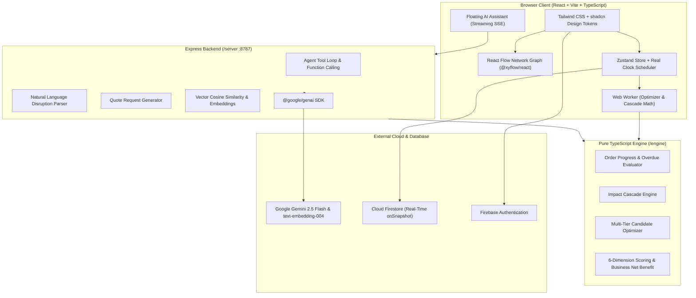

# ChainTwin AI — Autonomous Supply Chain Digital Twin Recovery Agent

> **Autonomous Digital Twin Recovery Agent**: Detect multi-tier supply chain disruptions in real time, simulate downstream dependency cascades with verified mathematical precision, and orchestrate diverse, explainable recovery plans.

[](https://www.typescriptlang.org/)
[](https://react.dev/)
[](https://tailwindcss.com/)
[](https://reactflow.dev/)
[](https://ai.google.dev/)
[](https://firebase.google.com/)

---

## 1. Problem Statement & Hackathon Criteria Mapping

Modern manufacturing supply chains operate across delicate multi-tier supplier dependencies. When a critical tier-1 spinning mill or chemical plant experiences unexpected downtime, the ripple effect propagates invisibly: inbound shipments stall, factory raw material buffers drain, production schedules collapse, regional distribution centres stock out, and customer retail commitments breach SLA contracts with severe liquidated damage penalties.

ChainTwin AI solves this challenge by serving as an **Autonomous Digital Twin Recovery Agent** for plant managers, mapped directly against the hackathon evaluation measures:

| Hackathon Measure | How ChainTwin AI Implements It |
| :--- | :--- |
| **Disruption Detection** | Continuous real-clock scheduler monitors overdue inbound POs and factory inventory days of cover to surface manager-confirmed early-warning signals before assembly starvation occurs. |
| **Dependency Reasoning** | End-to-end 6-stage lifecycle tracking (`Supplier Dispatch → Material Received → Production → At DC → At Store → Customer Delivery`). Accurately recognizes that orders whose material has already been received remain **100% SAFE**. |
| **Recovery-Plan Diversity** | Generates non-duplicate, multi-tier recovery plans: **Plan A (Balanced / Recommended)**, **Plan B (Speed / Resilient split-sourcing)**, **Plan C (Internal mitigations only)**, and a **Do Nothing Baseline**. |
| **Optimization Quality** | Pure TypeScript calculation engine evaluates multi-tier levers: inter-factory stock rebalancing, finished goods DC transfers, line overtime, backup supplier quotes, and approved material substitutes. |
| **Adaptability** | Completely schema-driven architecture. Zero hardcoded business entities; any dataset matching the 15-sheet schema operates dynamically. Real-time Firestore `onSnapshot` listeners ensure instant multi-device reactivity. |
| **Business Impact** | Quantifies financial loss avoided vs extra procurement cost, calculating net benefit in real INR, late orders protected, and carbon emissions. |

---

## 2. Core Architecture



---

## 3. Real-Time & Real-Date Guardrails

* **Real Clock & Timezone**: "Now" is the real date and time from the user's browser clock, ticking every second. The engine **never calls `new Date()` or `Date.now()` internally**; all calculations take an explicit injected `now` parameter.
* **Automatic Date Rebasing**: When loading dataset files with older `as_of_date` snapshots (e.g. 2026-10-31), the importer calculates the exact calendar day delta and rebases all orders, stages, inbound POs, and quote dates forward so the network appears active today.
* **Known vs Assumption Visual Style**: Every fact on screen is strictly categorized:
  * **Known**: Sourced directly from factory ERP records and signed contracts.
  * **Assumption**: Quotes, unapproved substitutes, and time-travel projections. Styled with an amber dotted underline and an `"Assumption"` badge.
* **Human-in-the-Loop Governance**: AI never invents disruptions, suppliers, or prices. The plant manager enters the disruption or confirms early warnings. Plans follow a strict 3-state workflow: **Proposed → Previewed → Finalised**.

---

## 4. Tech Stack

* **Frontend**: React 18, Vite 6, TypeScript 5.7, Tailwind CSS 3.4, `@xyflow/react` (React Flow 12), Recharts, Zustand 5, Lucide React, Date-fns.
* **Shared Engine**: Pure TypeScript (`/engine`) with Vitest unit tests.
* **Backend API**: Express 4, Node 24, `@google/genai` (Official Google Gen AI SDK), CORS, dotenv.
* **Database & Auth**: Firebase Auth (Email/Password & Google) + Cloud Firestore with real-time `onSnapshot` listeners and local demo mode fallback.

---

## 5. Folder Layout

```
├── .env.example                # Vite frontend environment template
├── .env                        # Vite frontend environment variables
├── firestore.rules             # User workspace security rules
├── index.html                  # HTML5 entrypoint
├── package.json                # Root package scripts and dependencies
├── tailwind.config.js          # Status token color configuration
├── tsconfig.json               # TypeScript path alias configuration
├── vite.config.ts              # Vite bundler configuration
│
├── engine/                     # PURE TYPESCRIPT CALCULATION ENGINE
│   ├── index.ts                # Unified engine entrypoint
│   ├── types.ts                # Universal supply chain data schemas
│   ├── clock.ts                # Date-fns injected-now utilities & date rebasing
│   ├── orderProgress.ts        # 6-stage progress tracker & overdue alert scanner
│   ├── impact.ts               # Multi-tier disruption cascade simulator
│   ├── scoring.ts              # 6-dimension scoring & business net benefit math
│   ├── optimizer.ts            # Level 1 internal & Level 2 backup supplier optimizer
│   └── __tests__/              # Vitest engine unit tests
│       └── engine.test.ts
│
├── server/                     # NODE + EXPRESS BACKEND (:8787)
│   ├── .env.example            # Backend Gemini environment template
│   ├── .env                    # Backend environment keys
│   ├── index.ts                # Express API routes (SSE agent, parse, explain, RAG)
│   ├── gemini.ts               # Google Gen AI SDK initialization & fallback logic
│   └── tools.ts                # Agent function calling tool execution
│
├── src/                        # FRONTEND REACT APPLICATION
│   ├── App.tsx                 # Protected router & layout wrapper
│   ├── main.tsx                # React DOM root
│   ├── index.css               # Tailwind directives & design tokens
│   ├── components/
│   │   ├── layout/             # Sidebar, TopBar with ticking clock, CommandPalette
│   │   ├── graph/              # React Flow TwinGraph & TwinNode components
│   │   ├── dashboard/          # Disruption modal with natural language parser
│   │   └── chat/               # Floating AI assistant drawer with SSE streaming
│   ├── pages/                  # 7 core application pages
│   │   ├── Login.tsx           # Firebase & 1-click Demo mode sign-in
│   │   ├── Dashboard.tsx       # Live Digital Twin telemetry & KPI strip
│   │   ├── DataManager.tsx     # Universal schema-driven table editor & importer
│   │   ├── BackupSuppliers.tsx # Backup supplier registry & AI RFQ drafter
│   │   ├── WhatIfSimulator.tsx # Sandboxed simulation copy & time travel slider
│   │   ├── RecoveryPlanner.tsx # Multi-tier plan comparison & approval engine
│   │   ├── AlertsHistory.tsx   # Arrival confirmations, audit log & undo rollback
│   │   └── KnowledgeBase.tsx   # RAG semantic search & policy markdown viewer
│   ├── store/                  # Central Zustand store (useSupplyChainStore)
│   ├── workers/                # Background Web Worker (optimizer.worker.ts)
│   └── lib/                    # Firebase config & sample data loaders
│
└── public/
    ├── logo.svg                # Brand SVG vector icon
    └── sample/                 # STARTER DATASETS & KNOWLEDGE BASE
        ├── tiruppur_tshirt_supply_chain_data.xlsx
        ├── csv/                # 15 individual sheet CSV files
        └── knowledge/          # 5 synthetic markdown policy documents
```

---

## 6. Step-by-Step Installation & Setup

### Prerequisites
* **Node.js**: v18.0.0 or higher (v24.18.0 tested)
* **npm**: v9.0.0 or higher (v11.16.0 tested)

### 1. Install Dependencies
```bash
npm install
```

### 2. Configure Environment Files

#### Frontend (`/.env`):
```env
VITE_FIREBASE_API_KEY=your_api_key
VITE_FIREBASE_AUTH_DOMAIN=your_project.firebaseapp.com
VITE_FIREBASE_PROJECT_ID=your_project_id
VITE_FIREBASE_STORAGE_BUCKET=your_project.appspot.com
VITE_FIREBASE_MESSAGING_SENDER_ID=your_sender_id
VITE_FIREBASE_APP_ID=your_app_id
VITE_API_BASE_URL=http://localhost:8787
```
*(If Firebase keys are not provided, ChainTwin AI automatically runs in local demo mode).*

#### Backend (`/server/.env`):
```env
GEMINI_API_KEY=your_gemini_api_key
GEMINI_MODEL=gemini-2.5-flash
GEMINI_EMBEDDING_MODEL=text-embedding-004
PORT=8787
ALLOWED_ORIGIN=http://localhost:5173
```
*(Obtain a key from [Google AI Studio](https://aistudio.google.com/). If omitted, the backend runs with smart local heuristic fallbacks).*

### 3. Run Unit Tests
```bash
npm test
```
All unit tests validate date rebasing, stage progress, disruption cascades, safe-order preservation, and multi-tier plan generation.

### 4. Start the Application
Run both frontend and backend concurrently:
```bash
npm run dev
```
* **Frontend**: Open [http://localhost:5173](http://localhost:5173)
* **Backend Health**: [http://localhost:8787/api/health](http://localhost:8787/api/health)

---

## 7. 5-Minute Hackathon Demo Script

1. **Sign In**: Navigate to [http://localhost:5173/login](http://localhost:5173/login). Click **"Launch Live Digital Twin Demo"** for instant access.
2. **Observe Calm Normal State**: The dashboard displays all 12 customer orders on track. In the normal state, there is **zero red or orange** on the screen. The top bar shows the real ticking clock and timezone.
3. **Trace an Order**: Click **ORD-1001** on the orders panel. Notice the React Flow graph highlights its full 6-stage pathway: Supplier SUP-01 → Yarn MAT-01 → Unit 1 (Veerapandi) → Chennai DC → Madras Mart Retail Store → Customer CUS-01.
4. **Report a Disruption**:
   * Click **"Report Disruption"**.
   * Type in plain words: *"Sri Kumaran spinning mill boiler outage for 10 days starting tomorrow"*.
   * Click **"Parse"** (Gemini extracts SUP-01, tomorrow's date, 10 days).
   * Click **"Simulate Impact & Generate Plans"**.
5. **Inspect the Ripple Cascade**:
   * Nodes turn red/amber.
   * **Safe Order Rule**: Notice that **ORD-1001 remains SAFE (green)** because its "Material received" stage was already completed before the outage!
   * Later orders like **ORD-1003 turn red** with projected SLA penalties.
6. **Compare Diverse Recovery Plans**:
   * Click **"Review Recovery Plans"**.
   * Compare **Plan A (Recommended - Sourcing + Rebalancing)**, **Plan B (Max Speed / Split-Sourcing)**, and **Plan C (Internal Buffers Only)** against the **Do Nothing Baseline**.
   * Click **"Why this plan?"** to inspect explainability and citations.
7. **Preview and Finalise**:
   * Click **"Choose to Preview"** to test dashboard counters without modifying records.
   * Click **"Finalise Plan"** to commit the recovery route.
8. **Real-Time Data Edit & Undo**:
   * Open **Data Manager** (`/data`), edit any stock quantity or supplier reliability, and watch the dashboard update instantly across windows.
   * Open **Alerts & History** (`/alerts`) and click **"Undo Plan"** to demonstrate complete state rollback.

---

## 8. License

MIT License. Built for the Google DeepMind & Gemini Autonomous Supply Chain Challenge.
